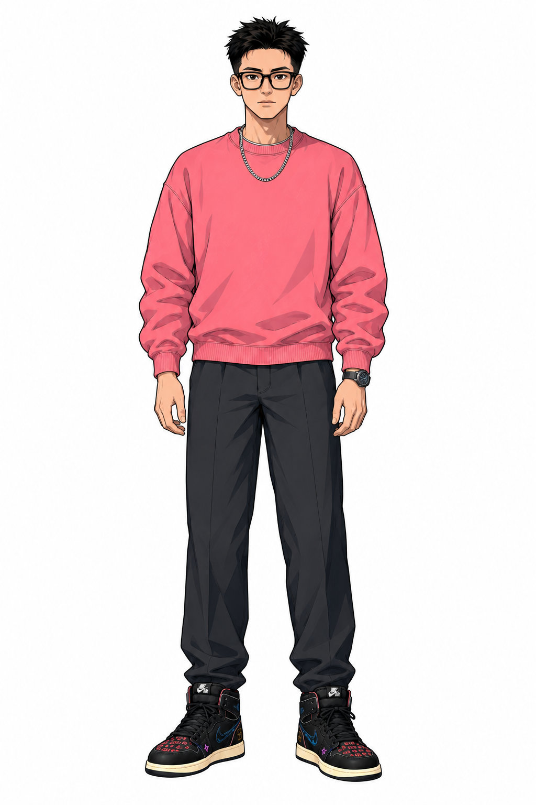
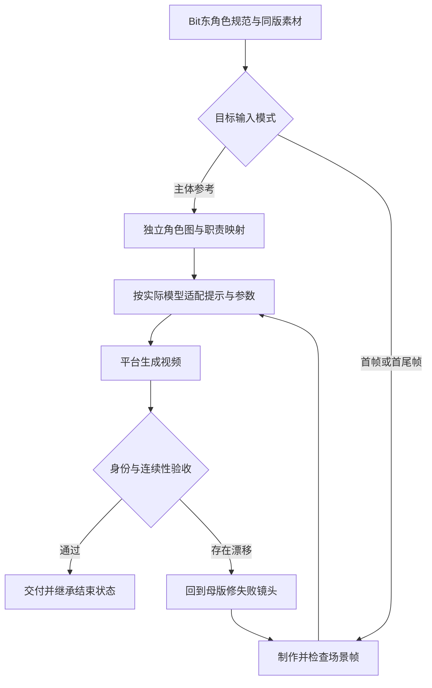

# BIT东 · IP角色与视频 Skill

将 Bit东 的个人动漫形象整理为可复用的角色规范、独立参考图与视频制作流程，支持角色定板、分镜、图生视频和跨平台移交。保留原来的文章插画能力。

**Skill工作流版本：2.0。技术名仍为 `bitdong-illustrations`，原调用方式继续有效。**

## 先看当前状态

- 既有角色设计沿用仓库原版：短刺黑发、矩形黑框眼镜、粉色圆领无帽卫衣、银链、炭黑长裤、定制黑色高帮鞋。
- 新增5张独立角色参考**候选图**，没有将未经用户选定的外观冒充最终定稿。
- 提供可灵、即梦/Seedance、Runway与Google Veo的流程适配及官方来源；参数必须按实际型号与网页/API入口核验。
- 提供可运行的素材校验和打包工具；**没有内置视频API调用，也没有声称完成跨模型视频实拍验证。**

这个Skill由支持Skills的助手读取，负责准备角色、镜头与素材。视频平台实际接收的是图片、提示词和其支持的参数；无需假设视频模型能直接读取 `SKILL.md`。

## 相比原版改变了什么

| 原版 | 当前工作流 |
| --- | --- |
| 以16:9白底文章配图为中心 | 视频、角色定板为主，文章插画作为保留模式 |
| 每次混合照片、角色拼板和表情表 | 固定动画版本，按用途选最少必要参考 |
| 来源图与“最终母版”界限不清 | 登记source / candidate / approved / archived |
| 参考文件只有路径 | 记录ID、真实尺寸、哈希、来源、职责与缺陷 |
| 缺少镜头状态交接 | 每镜头记录起终状态、持物手、手表、方向和光线 |
| 一套长提示词 | 按主体参考、首帧、首尾帧分别输出中英文提示 |
| 依靠人工找文件 | 校验并导出原图、上传顺序、逐镜头提示与记录 |

## 独立角色参考

以下为待选定的候选套装，不是已验收母版。原始图片未插值放大，生成提示与来源保留在同目录。

| 参考 | 文件 | 原生尺寸 |
| --- | --- | --- |
| 正面全身 | [bitdong-front.png](assets/character-reference/video-v2-candidates/bitdong-front.png) | 1024×1536 |
| 三分之四全身 | [bitdong-three-quarter.png](assets/character-reference/video-v2-candidates/bitdong-three-quarter.png) | 1024×1536 |
| 朝画面右侧90°侧面 | [bitdong-profile-right.png](assets/character-reference/video-v2-candidates/bitdong-profile-right.png) | 1024×1536 |
| 正背面 | [bitdong-back.png](assets/character-reference/video-v2-candidates/bitdong-back.png) | 1024×1536 |
| 正面面部近景 | [bitdong-face-front.png](assets/character-reference/video-v2-candidates/bitdong-face-front.png) | 1254×1254 |



五张图可以用于外观审阅和明确标注的生成草案。鞋子精细图案/字样仍需统一；背面结构和左腕手表为候选版本细节；BIT/DONG左右脚映射尚未确定。详细问题见 [素材登记表](assets/asset-manifest.json) 和 [母版制作规范](references/character-sheet-production.md)。不把这些图称为4K或完整360°资产。

## 使用示例

### 用现有IP设计视频

```text
使用 $bitdong-illustrations，沿用当前Bit东的外观，
为可灵设计一条15秒、9:16的个人IP介绍视频。
先给我镜头方案、每段参考素材和可粘贴提示词，
同一人物和服装贯穿全片；明确哪些素材还没定稿。
```

### 对接即梦或其他平台

```text
用Bit东角色做一条工作室口播短片，我在即梦网页端操作。
给我每个镜头需要上传的图、上传顺序、中文提示词和连续性记录。
不清楚当前界面支持的参数就标出来，不要虚构API字段。
```

### 制作和选定角色母版

```text
使用 $bitdong-illustrations，检查这套Bit东候选角色板，
保留脸型、矩形眼镜和服装，只统一定制鞋的细节。
每个角度独立输出，列出变化和待验收项。
```

用户选定实际文件后，记录批准依据与哈希，再冻结为当前母版。普通后续镜头沿用该版本，不重复确认角色。

### 保留原文章配图

```text
使用 $bitdong-illustrations，为下面文章生成3张16:9白底正文插画：
<文章>
```

## 安装与更新

使用 [skills CLI](https://github.com/vercel-labs/skills) 安装到支持的助手。沿用原有技能名：

```bash
npx skills add grennd-hand/bit-dong --skill bitdong-illustrations -g -a codex -y
```

也可以手动克隆到你的助手技能目录；以Codex为例：

```bash
git clone https://github.com/grennd-hand/bit-dong.git "$HOME/.codex/skills/bitdong-illustrations"
```

若已有Git安装，先保留自己的修改，再在该目录执行 `git pull --ff-only`。通过其他安装器安装的副本不会自动随仓库更新，请按该安装器的更新方式处理，避免重复安装两个版本。这里不附带任何平台密钥或视频生成额度。

## 校验并导出示例包

仅需Python 3.9及以上，无第三方Python依赖。示例是一条分为两个镜头的10秒问候策划，尚未生成视频；其中每段5秒是策划值，需要按目标平台重查。

在仓库根目录执行：

```bash
python3 scripts/prepare_video_pack.py \
  --plan templates/shot-plan.example.json \
  --out /tmp/bitdong-video-draft \
  --allow-draft
```

输出包含：

- 所选参考图片的原始字节副本。
- 每个镜头的 `prompt.zh.txt`、`prompt.en.txt`、`shot.json` 和 `upload-map.json`。
- 整体 `pack.json` 与使用说明，保留角色版本、输入模式及未核验事项。
- 平台引用名称初始为 `null`；上传后填写真实标签，不把本地ID当平台ID。

默认不带 `--allow-draft` 时，必须提供已批准的同版素材和完整的平台记录；当前候选示例会被正确拒绝。工具不会因为 `--allow-draft` 就允许旧拼图/真人来源/归档图充当视频输入。输出目录非空时拒绝覆盖。

模板见 [shot-plan.example.json](templates/shot-plan.example.json)。用 [quality-review.example.json](templates/quality-review.example.json) 分开记录结构检查、图片检查和视频检查。工具检查记录是否完整，不替你验证平台真实可用性或视觉相似度。

## 流程



## 文件入口

| 文件 | 用途 |
| --- | --- |
| [SKILL.md](SKILL.md) | 助手执行入口与任务路由 |
| [character-canon.json](references/character-canon.json) | 角色版本、恒定项和批准套装 |
| [bitdong-character.md](references/bitdong-character.md) | 视觉规范与冲突处理 |
| [asset-manifest.json](assets/asset-manifest.json) | 全部素材的状态、来源、尺寸与哈希 |
| [video-workflow.md](references/video-workflow.md) | 分镜、首帧、连续性和返工 |
| [model-adapters.md](references/model-adapters.md) | 各平台入口差异与官方来源 |
| [prompt-template.md](references/prompt-template.md) | 六类中英文提示模板 |
| [prepare_video_pack.py](scripts/prepare_video_pack.py) | 结构校验与原图打包 |

## 验证范围

运行工具的测试：

```bash
python3 -B -m unittest discover -s tests -p 'test_prepare_video_pack.py' -v
```

这些检查覆盖版本与输入模式、文件哈希/尺寸、目录范围、未经批准素材、连续性、原图复制及UTF-8交付等。它们不调用视频模型，也不证明视频角色已完全一致。实际平台视频验收应使用真实生成结果。

## 许可

保留原仓库未附带开源许可证的状态。本次修改未扩大角色、照片或其他素材的授权范围。
