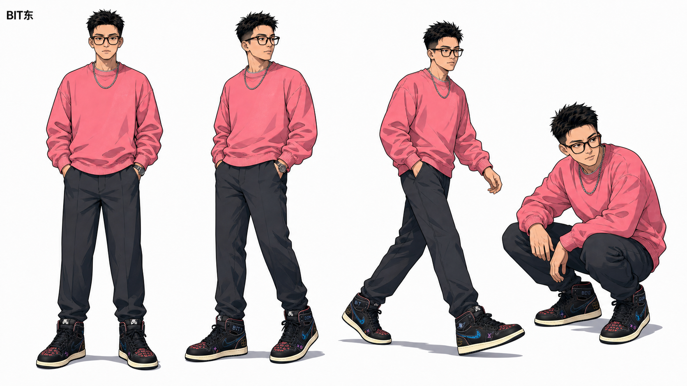

# Bit东插画 Skill

为中文文章、帖子、博客和 Notion 文档设计并生成以 **Bit东** 为固定视觉主体的 16:9 横版正文插画。



## 能做什么

- 阅读中文正文并提炼适合配图的认知节点
- 先输出 1–9 张图的配图策略与 shot list
- 直接生成成熟动漫风、清爽怪诞的正文插画
- 保持 Bit东的脸部、服饰、情绪、动作和定制鞋一致
- 根据叙事选择工作情绪、社交情绪和身体语言参考
- 检查并修正角色失真、画面过满、PPT 感、中文错字等问题

## 环境要求

- 支持 Skills 的 Codex 环境
- 可调用 `image_gen` 的图片生成能力
- Git（仅手动安装或更新时需要）

## 安装

### 方法一：让 Codex 自动安装

在 Codex 中发送：

```text
请使用 $skill-installer 从 https://github.com/grennd-hand/bit-dong 安装 bitdong-illustrations Skill。
```

安装完成后，在下一轮对话中即可使用。

### 方法二：使用 Skill Installer 脚本

macOS / Linux：

```bash
python "$HOME/.codex/skills/.system/skill-installer/scripts/install-skill-from-github.py" \
  --repo grennd-hand/bit-dong \
  --path . \
  --name bitdong-illustrations
```

Windows PowerShell：

```powershell
python "$HOME\.codex\skills\.system\skill-installer\scripts\install-skill-from-github.py" `
  --repo grennd-hand/bit-dong `
  --path . `
  --name bitdong-illustrations
```

### 方法三：使用 Git 手动安装

macOS / Linux：

```bash
git clone https://github.com/grennd-hand/bit-dong.git \
  "$HOME/.codex/skills/bitdong-illustrations"
```

Windows PowerShell：

```powershell
git clone https://github.com/grennd-hand/bit-dong.git `
  "$HOME\.codex\skills\bitdong-illustrations"
```

如果目标目录已经存在，请先更新现有安装，不要重复克隆。安装或更新后，重新打开 Codex 或在下一轮对话中调用该 Skill。

## 使用方法

### 直接生成文章配图

```text
使用 $bitdong-illustrations，为这篇中文文章设计并生成 5 张正文配图：

<粘贴文章正文>
```

### 只要配图方案，不立即生成

```text
用 Bit东插画分析这篇文章应该在哪里配图。先输出 shot list，不要生成图片。
```

### 指定数量与重点

```text
使用 $bitdong-illustrations 生成 3 张 16:9 插画，重点表现“卡住、顿悟、形成闭环”三个节点。
```

### 修改已有图片

```text
用 Bit东插画修改这张图：保留构图，让 Bit东更成熟，表情改成轻度怀疑，并修正鞋子的 BIT / DONG 图案。
```

## 默认视觉规则

- 画布：16:9 横版正文配图
- 背景：干净纯白，大量留白
- 角色：成年中国男性动漫角色 Bit东
- 身份锚点：短刺黑发、深色矩形眼镜、粉色卫衣、银色链条、定制黑色高帮鞋
- 画风：利落现代动漫墨线、克制赛璐璐明暗、少量中文手写批注
- 禁止：Q 版、萌系、未成年感、商业 PPT 风、复杂架构图、小黑实心怪物或无关吉祥物

完整工作流与约束见 [SKILL.md](SKILL.md)。

## 仓库结构

```text
bit-dong/
├── SKILL.md                         # Skill 主指令
├── agents/openai.yaml               # Codex 展示名称与默认提示词
├── references/                      # 角色、情绪、构图、提示词和质检规则
└── assets/
    ├── character-reference/         # Bit东身份、造型、表情、姿态与鞋子参考
    └── examples/                    # 旧风格案例，仅用于理解密度与留白
```

## 更新

Git 安装方式可以在 Skill 目录中执行：

```bash
git pull --ff-only
```

使用安装器安装时，如果目标目录已经存在，安装器会停止以保护本地内容。需要更新时，建议使用 Git 安装方式，或先自行备份已有目录。

## 使用注意

- 每次生图都应加载身份、动漫造型和鞋子三类固定参考。
- 情绪参考按场景选择一张，避免同时塞入所有参考图。
- `assets/examples/` 中包含旧风格案例，不能作为角色身份参考，也不要照抄构图。
- 角色必须参与画面的核心动作，不能只是站在旁边作为装饰。
- 一张图只表达一个核心结构，避免做成说明书或流程图。

## 许可说明

本仓库目前未附带开源许可证。公开可见不代表自动授权商用、修改或再分发；如需超出个人测试范围使用，请先联系仓库所有者取得许可。
